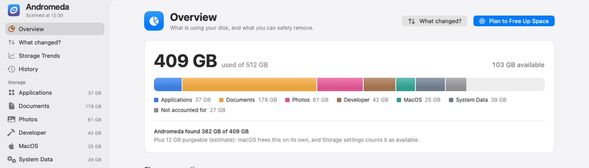

# Andromeda

**Storage, explained.** See what takes up space on your Mac, understand System Data, and review what you want to clean up, organize, or archive.

[Download for Mac](https://github.com/jYannni/andromeda-releases/releases/latest) · [All releases](https://github.com/jYannni/andromeda-releases/releases) · [Videos](#videos) · [Pricing](#planned-pricing)

## Download

Andromeda requires **Apple silicon and macOS 26 or later**.

| Channel | Download |
| --- | --- |
| Stable release | [Andromeda 0.2.71](https://github.com/jYannni/andromeda-releases/releases/tag/v0.2.71) |
| Public Beta | [Andromeda 0.2.85 Public Beta](https://github.com/jYannni/andromeda-releases/releases/tag/v0.2.85-public-beta) |

1. Open the notarized DMG and drag Andromeda to Applications. If you used a DiskPlain private beta, quit it and install the public DMG to switch update feeds.
2. On first launch, choose **Scan with limited access** or grant **Full Disk Access** so Andromeda can measure more protected locations.
3. Find new builds in **Settings → Updates**. Use **Receive public beta updates** to opt in to prereleases. The [Sparkle feed](https://jyannni.github.io/andromeda-releases/updates/appcast.xml) lists both channels.

## What you can do

- **Understand your storage.** Break down System Data, browse by category or folder, and use Storage Map to find large files. Compare past scans and watch folders for growth.
- **Review cleanup.** Inspect exact duplicates, similar images, app leftovers, and known system files. Andromeda shows the action before you confirm. History can restore eligible files still in Trash. Some system actions and permanent deletions are irreversible.
- **Organize and make room.** Preview folder plans, automate familiar filing rules, and use Space Plan to compare cleanup, cloud, and archive options.
- **Work with external drives.** Search saved drive catalogs while disks are unplugged, compare drive scans, and verify archive copies.
- **Try the new Public Beta tools.** Version 0.2.85 adds Make Room, Archive Health, early space warnings, editable Organize Rules, and Scheduled Scripts. [What’s new in 0.2.85](https://github.com/jYannni/andromeda-releases/blob/main/docs/updates/Andromeda-0.2.85-public-beta.md)

## Videos

- [Preview the first-scan checklist](docs/demos/scan-checklist-preview.mp4) · 3 seconds
- [Review an exact duplicate and restore it from History](docs/demos/review-exact-duplicates.mp4) · 36 seconds
- [See what grew in a watched folder](docs/demos/watched-folder-growth.mp4) · 36 seconds
- [Find footage on an unplugged drive](docs/demos/offline-video-previews.mp4) · 32 seconds

The workflow demos use sample files and show builds recorded under the former DiskPlain name.

## Planned pricing

| Licences | Price |
| ---: | ---: |
| 1 | €1.99 |
| 2 | €3.49 |
| 5 | €6.99 |
| 10 | €9.99 |

The current downloads are available at no charge. These prices are for the future paid edition.

## Source and licence

The 0.2.85 Public Beta uses the [Andromeda Proprietary Software Licence](docs/Andromeda-Licence.txt). Source for the earlier [0.2.71 release](https://github.com/jYannni/andromeda-releases/tree/v0.2.71) and [0.2.77 Public Beta](https://github.com/jYannni/andromeda-releases/tree/v0.2.77-public-beta) remains available under the [GNU General Public License v3.0](LICENSE).

The source tree in this repository is the published GPL snapshot for 0.2.77. To build a published snapshot, check out its tag and run `swift build -c release` with Xcode and the macOS 26 SDK or later. The `VERSION` file identifies the snapshot.
